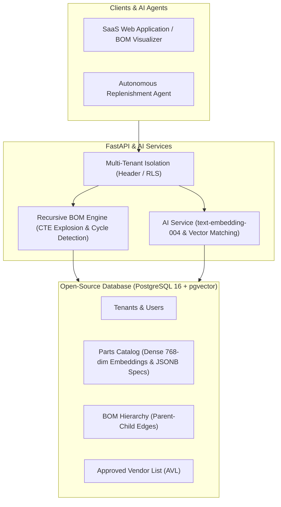
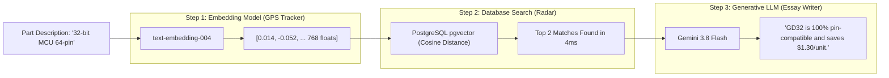

# AI-Native SCM Engine

An open-source, multi-tenant Supply Chain Management (SCM) SaaS engine built with **FastAPI**, **PostgreSQL 16**, and **`pgvector`**. Designed from the ground up around **Hierarchical Bill of Materials (BOM)**, semantic vector search for alternative parts, recursive cost rollups, and autonomous agent workflows.

---

## 1. System Architecture



---

## 2. Core Concepts & Educational Handbook

### Concept 1: What is "AI-Native"? (AI-Native vs. AI-Wrapper)

* **AI-Added (The "AI Wrapper"):** A traditional CRUD app with a chatbot widget glued on the side. If you remove the AI, 95% of the product continues working normally.
* **AI-Native:** Software engineered from Day 1 with artificial intelligence as a core structural element:
  1. **Data Model:** Unstructured engineering specs, datasheets, and vector embeddings (`pgvector`) are first-class database citizens alongside relational tables.
  2. **Workflows:** Autonomous agents make decisions (auto-replenishment, bottleneck forecasting, drop-in substitute recommendation) rather than requiring humans to manually click through 20-field forms.
  3. **If you remove AI:** The system cannot function because core capabilities (semantic part replacement, unstructured document ingestion) rely directly on vector spaces and probabilistic models.

---

### Concept 2: The Mental Model — "GPS Tracker" vs. "Essay Writer"

Modern AI systems achieve real-time performance by coordinating two distinct model types:



* **The GPS Tracker (Embedding Model, e.g. `text-embedding-004`):**
  * Does **NOT** generate sentences.
  * Maps text into a **768-dimensional geometric coordinate** in ~15 milliseconds for pennies ($0.00001).
  * Similar components receive coordinates close together; unrelated parts receive coordinates far apart.
* **The Essay Writer (Generative LLM, e.g. `gemini-3.8-flash`):**
  * Does **NOT** scan 100,000 database rows (which would take 45 seconds and cost $25 per query).
  * Reads **only the top 2 candidates** filtered by PostgreSQL and writes a clear engineering evaluation explaining pinouts, voltages, and lead-time trade-offs.

---

### Concept 3: Why PostgreSQL + `pgvector` is the Startup Superpower

Traditional startups stitch together 4 different paid enterprise services:

| Component | Traditional Stack | All-in-One PostgreSQL Stack |
| :--- | :--- | :--- |
| **Relational Core** | AWS Aurora / Oracle ($$$) | **PostgreSQL Core** (100% Free Open-Source) |
| **Vector Database** | Pinecone / Weaviate ($70–$200/mo) | **`pgvector`** extension (Included) |
| **Multi-Tenancy** | Complex application logic | **Row-Level Security (RLS)** (Engine level) |
| **Search Engine** | Elasticsearch / Algolia ($50–$150/mo) | **Full-Text Search + `pg_trgm`** (Included) |
| **Monthly Cost** | **$300 – $800+/month** | **$5 – $20/month** (or free on local Docker) |

---

### Concept 4: Multi-Tenant Hierarchical BOM Engineering

A Bill of Materials (BOM) is not a flat list; it is a **directed acyclic graph (DAG)**. 

#### 1. Cycle Prevention
Before inserting any parent-component edge, a Depth-First Search (DFS) runs to ensure that adding Part $B$ under Part $A$ will never create a circular reference (e.g. $A \rightarrow B \rightarrow C \rightarrow A$).

#### 2. Recursive CTE Explosion
A single recursive SQL CTE traverses unlimited hierarchy depths in milliseconds:
* Accounts for scrap factors (e.g., $+5\%$ scrap on magnets during motor winding).
* Rolls up total assembly cost from raw leaf components.
* Identifies the **critical-path lead time** (the longest component lead time that dictates factory delivery).

---

### Concept 5: Embedding Strategy Playbook

#### A. Combining Multiple Columns (The Document Template Pattern)
Instead of embedding individual columns in silos, concatenate `name`, `description`, and `specifications` into one structured document:

```python
text_to_embed = f"""
Part Number: {part.part_number}
Name: {part.name}
Specs: {json.dumps(part.specifications)}
Notes: {part.notes}
"""
```
* Now a single search bar matches across names, packages, voltage ratings, and vendor notes simultaneously.

#### B. Single vs. Multiple Vector Columns
* **Single Column (`embedding vector(768)`):** Standard for 90% of use cases. Simplifies indexing, uses less RAM, and allows holistic semantic search.
* **Multiple Columns (`technical_embedding`, `compliance_embedding`):** Used only when query personas must remain completely separate (e.g., engineering pinout searches vs. legal RoHS/conflict minerals searches).

#### C. Hybrid Search (SQL WHERE + Vector Proximity)
Never embed numbers or dates for range queries. Combine standard SQL filters with vector distance:

```sql
SELECT part_number, name, unit_cost
FROM parts
WHERE tenant_id = :tenant_id
  AND unit_cost <= 15.00              -- Deterministic SQL filter
  AND lead_time_days <= 10            -- Deterministic SQL filter
ORDER BY embedding <=> :query_vector  -- Semantic similarity sorting
LIMIT 5;
```

---

## 3. Quickstart & Installation

### Prerequisites
* Docker & Docker Compose
* Python 3.9+

### 1. Launch the Database
```bash
docker compose up -d
```
* PostgreSQL 16 with `pgvector` will start on `localhost:5432`.

### 2. Setup Virtual Environment
```bash
python3 -m venv .venv
source .venv/bin/activate
pip install -r requirements.txt
cp .env.example .env
```

### 3. Run the Automated Test Suite
```bash
pytest -v
```

### 4. Start the API Server
```bash
uvicorn app.main:app --reload --port 8000
```
Open **`http://localhost:8000/docs`** in your browser to explore the interactive Swagger API documentation.

---

## 4. Automated Test Scenarios

The test suite in `tests/` verifies each scenario discussed:

| Test File | Scenario Verified |
| :--- | :--- |
| **`test_01_pgvector_similarity.py`** | **Cosine Similarity Clustering:** Verifies microcontrollers cluster together (~99% match) while mechanical parts are rejected. |
| **`test_02_combined_columns.py`** | **Multi-Column Concatenation:** Verifies combined document vectors enable searching across properties stored in separate columns (`name`, `specifications`). |
| **`test_03_hybrid_search.py`** | **Hybrid Search:** Combines strict SQL filters (`unit_cost <= $15`) with vector proximity sorting. |
| **`test_04_bom_recursion.py`** | **Recursive BOM Explosion:** Traverses a 3-tier Drone assembly, calculating rolled-up cost with scrap factors and bottleneck lead times. |
| **`test_05_cycle_detection.py`** | **Cycle Detection:** Prevents self-references ($A \rightarrow A$) and multi-hop circular dependencies ($A \rightarrow B \rightarrow C \rightarrow A$). |
| **`test_06_multi_tenancy.py`** | **Tenant Isolation:** Ensures Tenant A cannot see, access, or explode Tenant B's parts. |

---

## 5. License

MIT License. Free and open source for startups and developers.
